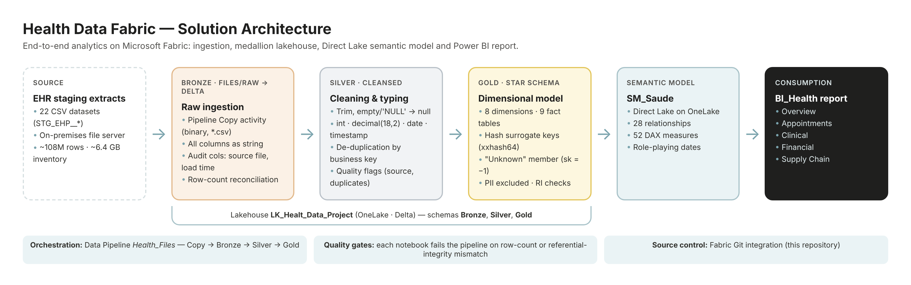
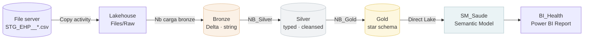
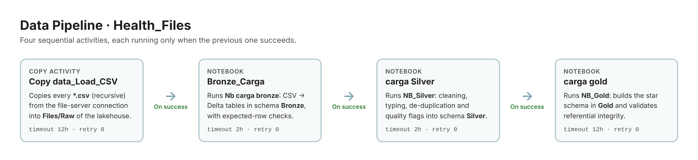
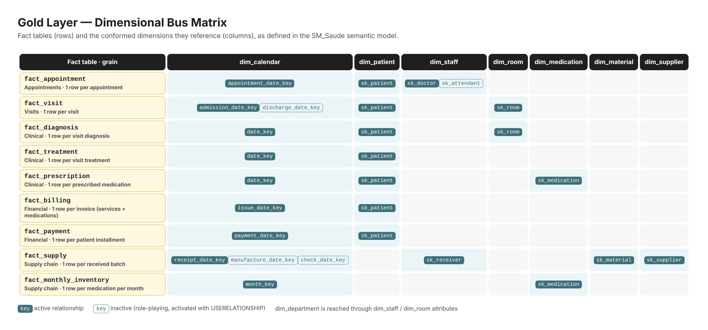
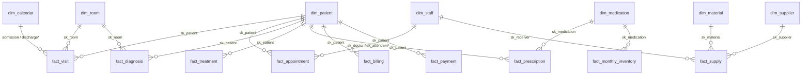
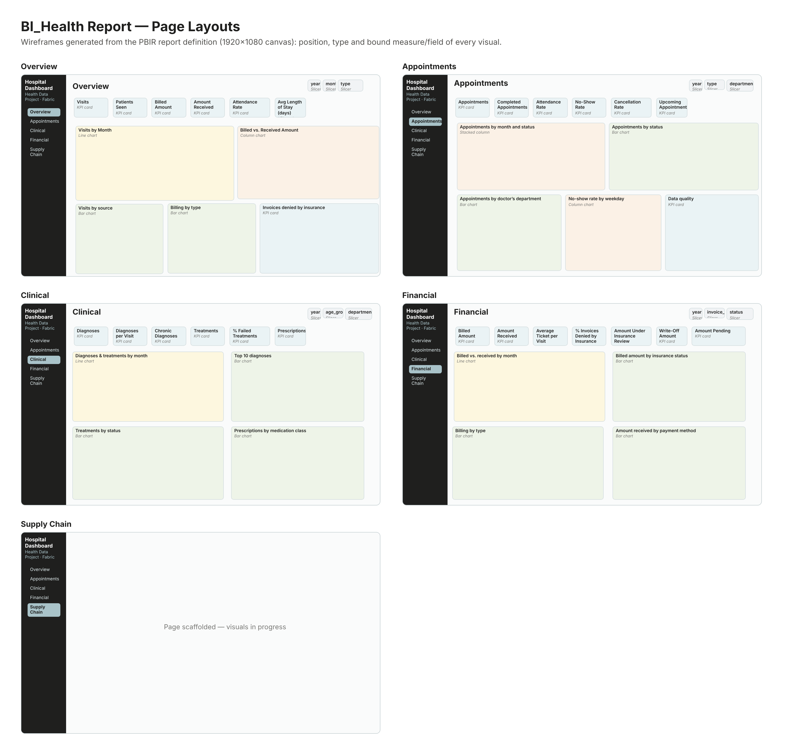

<div align="center">

# 🏥 Health Data Fabric

**End-to-end hospital analytics on Microsoft Fabric. It covers ingestion, a medallion lakehouse, a Direct Lake semantic model and a Power BI report.**


</div>

---

## 📑 Table of Contents

1. [Overview](#-overview)
2. [Solution Architecture](#-solution-architecture)
3. [Repository Structure](#-repository-structure)
4. [Data Sources](#-data-sources)
5. [Orchestration – Data Pipeline](#-orchestration--data-pipeline)
6. [Medallion Layers](#-medallion-layers)
   - [Bronze – Raw Ingestion](#-bronze--raw-ingestion)
   - [Silver – Cleansing & Typing](#-silver--cleansing--typing)
   - [Gold – Star Schema](#-gold--star-schema)
7. [Semantic Model (SM_Saude)](#-semantic-model-sm_saude)
8. [Power BI Report (BI_Health)](#-power-bi-report-bi_health)
9. [Data Quality & Governance](#-data-quality--governance)
10. [Getting Started](#-getting-started)
11. [Roadmap](#-roadmap)

---

## 🔎 Overview

**Health Data Fabric** is a complete analytics solution for a hospital's operational data, built entirely on **Microsoft Fabric**. It takes raw Electronic Health Record (EHR) staging extracts (patients, appointments, visits, diagnoses, treatments, prescriptions, billing, payments, suppliers and inventory) and turns them into a governed, analysis-ready **star schema** that feeds an interactive **Power BI** dashboard.

| Capability | Implementation |
|---|---|
| **Ingestion** | Fabric Data Pipeline (Copy activity) from an on-premises file server to OneLake |
| **Storage** | Fabric Lakehouse `LK_Healt_Data_Project` with Delta tables in `Bronze`, `Silver` and `Gold` schemas |
| **Transformation** | Three PySpark notebooks, one per medallion layer |
| **Modeling** | Kimball-style star schema with 8 dimensions and 9 facts |
| **Semantic layer** | `SM_Saude` in **Direct Lake** mode, with 28 relationships and 52 DAX measures |
| **Visualization** | `BI_Health` report with 5 pages: Overview, Appointments, Clinical, Financial and Supply Chain |
| **Source control** | Fabric Git integration. Every item is versioned in this repository |

**Data volume:** 22 source datasets totalling about **108 million rows**. The largest is daily inventory, with **90.7M rows** spread over 98 files (~6.4 GB).

---

## 🏗 Solution Architecture





---

## 📁 Repository Structure

This repository is synchronized with a Fabric workspace through **Fabric Git integration**. Each folder under `fabric/` is one Fabric item.

```
health-data-fabric/
├── README.md
├── docs/images/                         # Diagrams used in this README
└── fabric/
    ├── Health_Files.DataPipeline/       # Orchestration: Copy → Bronze → Silver → Gold
    │   └── pipeline-content.json
    ├── LK_Healt_Data_Project.Lakehouse/ # Lakehouse definition (default schema: dbo)
    ├── Nb carga bronze.Notebook/        # Bronze layer: CSV → Delta
    │   └── notebook-content.py
    ├── NB_Silver.Notebook/              # Silver layer: cleansing, typing, de-duplication
    │   └── notebook-content.py
    ├── NB_Gold.Notebook/                # Gold layer: dimensions, facts, integrity checks
    │   └── notebook-content.py
    ├── SM_Saude.SemanticModel/          # Semantic model in TMDL (Direct Lake)
    │   └── definition/
    │       ├── model.tmdl
    │       ├── relationships.tmdl
    │       ├── expressions.tmdl
    │       └── tables/                  # 17 tables + _Measures
    └── BI_Health.Report/                # Power BI report in PBIR format
        └── definition/pages/            # 5 pages, one visual.json per visual
```

---

## 🗂 Data Sources

The source files are EHR staging extracts that follow the naming pattern `STG_EHP__<ENTITY>.csv`. Large entities are split into several files inside a folder.

| Domain | Bronze table | Source file(s) | Description | Expected rows |
|---|---|---|---|---:|
| Patient | `patn` | `STG_EHP__PATN.csv` | Patient registry | 351,765 |
| Patient | `algy` | `STG_EHP__ALGY.csv` | Allergy catalog | 44 |
| Patient | `ptal` | `STG_EHP__PTAL.csv` | Patient allergies | 644,303 |
| Patient | `insr` | `STG_EHP__INSR.csv` | Insurance policies | 457,072 |
| Care | `appt` | `STG_EHP__APPT.csv` | Appointments | 974,032 |
| Care | `vist` | `STG_EHP__VIST.csv` | Visits / encounters | 917,331 |
| Care | `diag` | `STG_EHP__DIAG/*.csv` | Diagnoses | 1,602,174 |
| Care | `trtm` | `STG_EHP__TRTM.csv` | Treatments | 917,191 |
| Care | `tmmd` | `STG_EHP__TMMD/STG_EHP__TMMD_*.csv` | Prescribed medications | 3,209,411 |
| Billing | `bill` | `STG_EHP__BILL.csv` | Service invoices | 917,331 |
| Billing | `mdbl` | `STG_EHP__MDBL.csv` | Medication invoices | 465,152 |
| Billing | `pmnt` | `STG_EHP__PMNT/*.csv` | Patient payments (installments) | 2,774,514 |
| Organization | `dpmt` | `STG_EHP__DPMT.csv` | Departments | 30 |
| Organization | `roms` | `STG_EHP__ROMS.csv` | Rooms | 24,302 |
| Organization | `stff` | `STG_EHP__STFF.csv` | Staff | 5,496 |
| Organization | `medt` | `STG_EHP__MEDT.csv` | Medical teams | 312,870 |
| Supply chain | `mdcn` | `STG_EHP__MDCN.csv` | Medication catalog | 346,302 |
| Supply chain | `eqpm` | `STG_EHP__EQPM.csv` | Equipment catalog | 10,190 |
| Supply chain | `vndr` | `STG_EHP__VNDR.csv` | Vendors / suppliers | 13,562 |
| Supply chain | `sply` | `STG_EHP__SPLY.csv` | Supply batches received | 721,134 |
| Supply chain | `vpmt` | `STG_EHP__VPMT/*.csv` | Payments to vendors | 1,802,488 |
| Supply chain | `invn` | `STG_EHP__INVN/*.csv` (98 files) | Daily inventory per medication | 90,731,353 |

> ℹ️ `STG_EHP__TMMD.csv` is a duplicate copy of the split files and is deliberately excluded from the load.

---

## ⚙ Orchestration – Data Pipeline

The **`Health_Files`** pipeline runs the whole flow from start to finish. Each activity starts only after the previous one succeeds, so a failed quality check in any layer stops the downstream loads.



| # | Activity | Type | What it does | Timeout |
|---|---|---|---|---|
| 1 | `Copy data_Load_CSV` | Copy (binary) | Recursively copies `*.csv` from the file-server connection to `Files/Raw` in the lakehouse | 12 h |
| 2 | `Bronze_Carga` | Notebook | Runs **Nb carga bronze** | 2 h |
| 3 | `carga Silver` | Notebook | Runs **NB_Silver** | 2 h |
| 4 | `carga gold` | Notebook | Runs **NB_Gold** | 12 h |

---

## 🥉🥈🥇 Medallion Layers

### 🥉 Bronze – Raw Ingestion

**Notebook:** `Nb carga bronze` · **Target schema:** `Bronze`

- Reads every CSV in `Files/Raw` with `header=True` and `inferSchema=False`, so **all columns are loaded as strings**. Typing is left to Silver.
- Writes each entity as a **Delta table** in `overwrite` mode, which makes reloads idempotent.
- Adds two **audit columns**: `_arquivo_origem` (source file name, read from `_metadata.file_name`) and `_data_carga` (load timestamp).
- **Reconciles row counts** against the data dictionary. The notebook prints a status table (`OK` / `DIFERENTE` / `ERRO`) and **raises an exception** if any table fails, which stops the pipeline.

### 🥈 Silver – Cleansing & Typing

**Notebook:** `NB_Silver` · **Target schema:** `Silver`

The Silver layer applies the rules from the **Quality** tab of the data dictionary.

| Step | Rule |
|---|---|
| **1. Text cleansing** | Trims whitespace and converts empty strings and the literal `'NULL'` to real nulls |
| **2. Typing** | Codes become `int`, amounts become `decimal(18,2)`, and dates become `date` / `timestamp`. Dates are parsed from multiple formats (`yyyy-MM-dd`, `M/d/yyyy`, `M/d/yyyy H:mm`) |
| **3. Conversion audit** | Counts, per column, the populated values that could not be converted, so silent data loss is visible |
| **4. Keys & de-duplication** | Left-pads `ALG_ID` to 3 digits and de-duplicates `ptal`, `stff`, `roms`, `medt` and `invn` by business key |
| **5. Quality flags** | Derives new columns that flag known data issues (see below) |
| **6. Lineage** | Keeps `_data_carga_bronze` and adds `_data_carga_silver` |

**Table-specific rules**

| Table | Rule |
|---|---|
| `ptal` | One row per patient + allergy, keeping the one with the **highest severity** |
| `stff` | One row per `STF_ID`, keeping the **most recent ingestion** |
| `roms`, `medt` | One row per business key |
| `eqpm` | Renames `EQP_CAT__1/2/3` to `EQP_CAT_1/2/3` to match the ERD |
| `vist` | Adds `REFR_ORIGEM` (scheduled `AGENDAMENTO`, walk-in `E` or `W`) and `REFR_DUPLICADO` |
| `bill`, `mdbl` | Adds `REFR_DUPLICADO` |
| `diag`, `trtm`, `tmmd` | Adds `REFR_AMBIGUO`, which flags rows whose visit number is repeated so the patient cannot be determined |
| `sply` | Adds `MAT_TIPO` (`MEDICAMENTO` or `EQUIPAMENTO`) by matching against the medication and equipment catalogs |
| `invn` | One row per medication + day |

The notebook also runs spot checks: the distribution of visit sources, no supply rows with an unknown material type, and zero orphan allergy IDs.

### 🥇 Gold – Star Schema

**Notebook:** `NB_Gold` · **Target schema:** `Gold`

The Gold layer is a **Kimball dimensional model** made of 8 conformed dimensions and 9 fact tables.



**Dimensions**

| Table | Grain / content |
|---|---|
| `dim_calendario` | One row per day from 2023-01-01 to 2026-12-31: year, quarter, month, month names, weekday and a weekend flag |
| `dim_paciente` | Patient demographics, age and age band (reference date 2025-09-30), blood type, marital status, policy count, active insurance flag and allergy count. **No PII** |
| `dim_funcionario` | Staff name, gender, role, department, status, hire date and annual salary |
| `dim_departamento` | Department name, description and location |
| `dim_sala` | Room purpose, size, capacity and department |
| `dim_medicamento` | Medication class, form, strength, storage, status and package cost |
| `dim_material` | Union of medications and equipment, used by supply facts |
| `dim_fornecedor` | Vendor name, type, country and status |

**Facts**

| Table | Grain | Key metrics |
|---|---|---|
| `fato_agendamento` | Appointment | attended / cancelled / no-show flags |
| `fato_visita` | Visit | length of stay (days), visit source, duplicate flag |
| `fato_diagnostico` | Diagnosis within a visit | diagnosis code, status, recommended conduct |
| `fato_tratamento` | Treatment within a visit | treatment type, status |
| `fato_prescricao` | Prescribed medication | quantity, dosage, route, **estimated cost** |
| `fato_faturamento` | Invoice (services + medications) | invoice amount, amount paid by the patient |
| `fato_pagamento` | Patient installment | installment amount, method, status |
| `fato_fornecimento` | Supply batch | qty supplied / received / discrepancy, cost, paid, balance due, days to check |
| `fato_estoque_mensal` | Medication × month | opening / closing stock, received, issued, stockout days, negative-stock flag |

**Modeling principles**

- 🔑 **Deterministic surrogate keys.** `sk_*` columns are computed with `xxhash64` over the business key. The same input always produces the same key, so facts and dimensions join without a key-mapping table and any layer can be fully reloaded.
- ❔ **"Unknown" member.** Every dimension has a row with `sk = -1` ("Não informado"). Facts with a missing reference point to it, so no rows are dropped in Power BI.
- 📅 **Date keys** use the `YYYYMMDD` integer format and link to `dim_calendario`. Date keys that are null become `-1`.
- ⚠ **Ambiguous visits.** Diagnoses, treatments and prescriptions whose visit number is ambiguous are excluded from those three facts because the patient cannot be determined. They remain in `fato_visita`.
- 📉 **Aggregated inventory.** The 90.7M daily inventory rows are summarized into a **monthly** fact using `min_by` / `max_by` for opening and closing stock.
- 🔒 **Privacy by design.** Patient e-mail, phone number and ID document are **not** published to Gold.

---

## 🧠 Semantic Model (SM_Saude)

The semantic model is stored in **TMDL** and runs in **Direct Lake** mode over OneLake. Power BI reads the Gold Delta tables directly, with no import refresh and no data duplication. The Gold tables (named in Portuguese) are exposed under **English names** (`fato_visita` → `fact_visit`, `dim_paciente` → `dim_patient`, and so on).


<sub>* inactive (role-playing) relationship, activated in DAX through `USERELATIONSHIP`.</sub>

**Relationships:** 28 in total. Five are inactive role-playing relationships: attendant, visit discharge date, and supply manufacture and check dates.

**DAX measures (52)** are kept in a dedicated `_Measures` table and grouped into display folders:

| Folder | Examples |
|---|---|
| **Appointments** | `Appointments`, `Attendance Rate`, `No-Show Rate`, `Cancellation Rate`, `Upcoming Appointments`, `Appointments Booked by Attendant`, `Data Quality Status` |
| **Visits** | `Visits`, `Patients Seen`, `Visits per Patient`, `Avg Length of Stay (days)`, `% Scheduled Visits`, `Discharges by Discharge Date` |
| **Clinical** | `Diagnoses`, `Diagnoses per Visit`, `Chronic Diagnoses`, `Treatments`, `% Failed Treatments`, `Prescriptions`, `Estimated Medication Cost` |
| **Financial** | `Billed Amount`, `Amount Received`, `Amount Pending`, `Average Ticket per Visit`, `% Invoices Denied by Insurance`, `Write-Off Amount`, `Amount Under Insurance Review` |
| **Supply Chain** | `Closing Stock`, `Stock Received`, `Stock Issued`, `% Stockout Days`, `Supply Cost`, `Balance Due to Suppliers`, `% Receipt Discrepancy`, `Avg Days to Check` |

Example measures:

```dax
Attendance Rate =
DIVIDE ( [Completed Appointments], [Completed Appointments] + [No-Shows] )

Closing Stock =
VAR LastMonth = MAX ( fact_monthly_inventory[month_key] )
RETURN
    CALCULATE ( SUM ( fact_monthly_inventory[closing_stock] ),
                fact_monthly_inventory[month_key] = LastMonth )

Denied Invoices Status =
VAR p = [% Invoices Denied by Insurance]
VAR n = ROUND ( DIVIDE ( 1, p ), 0 )
RETURN
    IF ( NOT ISBLANK ( p ),
         IF ( p >= 0.10, "⚠ Attention · ", "✓ Normal · " ) & "1 in every " & n & " invoices" )
```

---

## 📊 Power BI Report (BI_Health)

The report is stored in the **PBIR** format, with one JSON file per page and per visual, so every change can be reviewed in Git. All pages share a 1920×1080 layout with a dark side navigation bar, a header with slicers and a row of KPI cards above the charts.



| Page | Purpose | KPI cards | Charts | Slicers |
|---|---|---|---|---|
| **Overview** | Executive summary of care and billing | Visits, Patients Seen, Billed Amount, Amount Received, Attendance Rate, Avg Length of Stay | Visits by month, billed vs. received, visits by source, billing by type, insurance denial card | Year, month, type |
| **Appointments** | Volume, attendance and no-shows | Appointments, Completed, Attendance Rate, No-Show Rate, Cancellation Rate, Upcoming | By month and status, by status, by doctor's department, no-show rate by weekday, data-quality card | Year, type, department |
| **Clinical** | Diagnoses, treatments and prescriptions | Diagnoses, Diagnoses per Visit, Chronic Diagnoses, Treatments, % Failed Treatments, Prescriptions | Diagnoses & treatments by month, top 10 diagnoses, treatments by status, prescriptions by medication class | Year, age group, department |
| **Financial** | Billing, insurance and patient payments | Billed, Received, Avg Ticket, % Denied, Under Review, Write-Off, Pending | Billed vs. received by month, billed by insurance status, billing by type, received by payment method | Year, invoice type, status |
| **Supply Chain** | Suppliers, batches and inventory | *in progress* | *in progress* | *in progress* |

> 💡 The **Data quality** card on the Appointments page shows appointments booked with a "doctor" registered in the IT department, a data-quality issue in the source (`STG_EHP__STFF`).

---

## ✅ Data Quality & Governance

Quality is enforced **inside the pipeline**, not only reported afterwards.

| Layer | Check | On failure |
|---|---|---|
| Bronze | Loaded rows = expected rows from the data dictionary, for each of the 22 tables | Exception, pipeline stops |
| Silver | Expected rows after de-duplication, plus a count of values that failed type conversion per column | Exception, pipeline stops |
| Silver | Spot checks: visit sources, material types, orphan allergy IDs | Reported |
| Gold | **Referential integrity**: 29 fact → dimension key checks (every non-`-1` key must exist in its target) | Exception, pipeline stops |
| Gold | Number of ambiguous-visit rows excluded from the clinical facts | Reported |

**Governance highlights**

- Full **lineage columns** in every layer (`_arquivo_origem`, `_data_carga_bronze`, `_data_carga_silver`, `_data_carga_gold`).
- **PII minimization**: contact data and ID documents never reach the Gold layer or the report.
- Every item (pipeline, notebooks, model, report) is **version-controlled** through Fabric Git integration.

---

## 🚀 Getting Started

### Prerequisites

- A **Microsoft Fabric** workspace with capacity (F SKU or trial)
- Access to the EHR CSV extracts through a file-server connection, or the files uploaded to `Files/Raw`
- Power BI Desktop (optional, for local editing of the PBIR/TMDL files)

### Deploying

1. **Connect the workspace to Git.** In *Workspace settings → Git integration*, point to this repository (branch `main`, folder `fabric/`) and sync. All items are created automatically.
2. **Configure the source connection.** Open `Health_Files` and set the file-server connection used by `Copy data_Load_CSV` (or upload the CSVs manually to `Files/Raw`, keeping the folder names).
3. **Attach the lakehouse.** Make sure `LK_Healt_Data_Project` is the default lakehouse of the three notebooks.
4. **Run the pipeline.** Trigger `Health_Files`. It loads Bronze, then Silver, then Gold, and validates each layer.
5. **Refresh the semantic model.** `SM_Saude` uses Direct Lake, so it picks up the new Gold tables automatically (run a *refresh* to reframe if needed).
6. **Open the report.** Open `BI_Health` and explore.

> ⏱ The `invn` table (90.7M rows, 98 files) is the longest step in both the Bronze and Silver layers.

---

## 🗺 Roadmap

- [ ] Finish the **Supply Chain** report page (stock, stockouts, supplier payments, receipt discrepancies)
- [ ] Incremental loads (Delta `MERGE`) instead of full overwrite for the large facts
- [ ] Scheduled pipeline trigger and failure alerts
- [ ] Row-level security by department
- [ ] Pipeline parameters for workspace / lakehouse IDs to support Dev → Test → Prod deployment

---

<div align="center">

Built with Microsoft Fabric · PySpark · Delta Lake · Power BI

</div>
